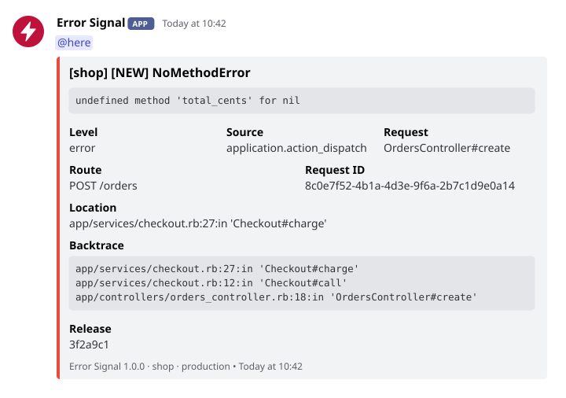
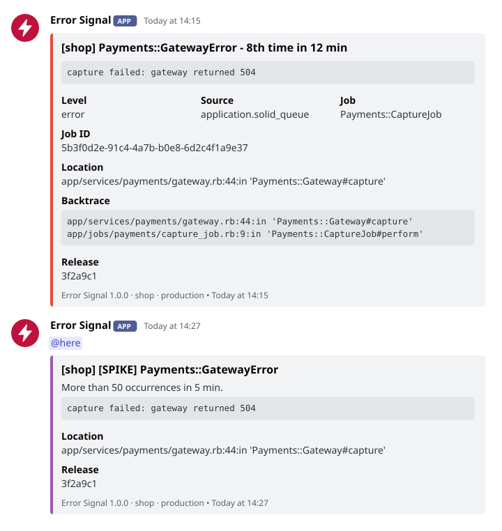
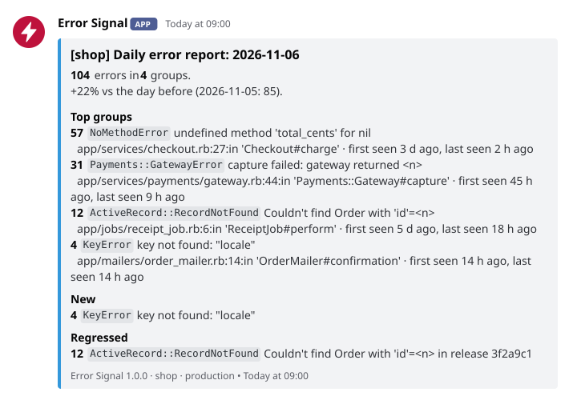
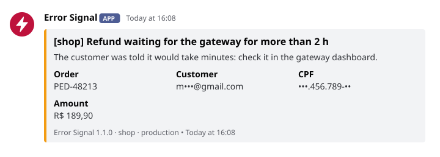

# Error Signal

English | [Português](README.pt-BR.md)

[](https://github.com/matt-3/error_signal/actions/workflows/test.yml)
[](LICENSE)


**Sentry-like alerts and daily/weekly error reports for Rails, posted to Discord: free, no
service, no database, no personal data.** Error Signal listens to `Rails.error`, the error
reporter every Rails app has, groups what it hears, tells you when an error is new, when
it came back after a deploy and when it spikes, and sends a daily and a weekly report to
the same channel.

<picture>
  <source media="(prefers-color-scheme: dark)" srcset="docs/assets/alert-dark.svg">
  
</picture>

- **Nothing to run.** No service, no agent, no database: a Gemfile line and a webhook URL.
  No initializer and no call in your code.
- **Alerts that say what changed.** `[NEW]`, `[REGRESSED]` after a deploy, `[SPIKE]`. A
  repeated error posts on its 1st, 2nd, 4th, 8th... occurrence, so a loop sends a handful
  of messages, not hundreds.
- **What you need to act.** The logged-in user, the context your code passes, the cause,
  the failing line of code, the process, and how many people the error reached.
- **Reports in the channel.** Every morning the day before, every week the trend: totals,
  top groups, what is new, what came back, what disappeared.
- **No personal data.** The message, the backtrace and the ids go through a sanitizer
  before leaving: personal data keeps only the part that tells records apart
  (`•••.456.789-••`, `j•••@gmail.com`, `•••• 4242`), secrets go whole (`[FILTERED]`).
  Of the user, only the id; besides the context your own code passes, nothing from the
  request leaves: no params, headers, URL, cookies or session.
- **Yours to tune.** Choose what posts by level, class, source or a Ruby rule, and post
  your own messages with `ErrorSignal.message`.
- **Safe in production.** It never raises, never blocks a request (the POST runs in a
  thread with short timeouts) and costs a few cache operations per error.
- **With or without Sentry.** Both listen to `Rails.error` side by side.

## What it is for

Error Signal tells you, in the channel you already watch, that an error is happening
**now**: what it is, where in the code, for whom and how often, and whether it is new or
came back after a deploy. That is the whole job. It is not an error tracker:

| It answers | It does not keep |
|---|---|
| Is something breaking right now? Since when, how often, for how many people? | Every occurrence, one by one, with its request |
| Is it new, or did the last deploy bring it back? | A list of errors to browse, search, assign or mark as resolved |
| Where in the code, with what context and what cause? | Params, headers, breadcrumbs or the steps before the error |
| How did yesterday and this week go? | Months of history, performance data, traces, browser errors |

Its memory is a few counters in `Rails.cache`, enough to tell new from regressed, count a
burst and write the daily and weekly reports. When you need to investigate after the fact,
use a tracker: [Sentry](https://sentry.io), or
[solid_errors](https://github.com/fractaledmind/solid_errors) in your own database. Both
listen to `Rails.error` next to Error Signal, so the alert comes here and the archive stays
there ([together with Sentry](#together-with-sentry)).

## Contents

- [What it is for](#what-it-is-for)
- [Quick start](#quick-start)
- [What it catches](#what-it-catches)
- [Alerts](#alerts)
- [Reports](#reports)
- [Examples by scenario](#examples-by-scenario)
- [Configuration](#configuration)
- [Sanitizer](#sanitizer)
- [Rake tasks](#rake-tasks)
- [Compatibility](#compatibility)
- [Compared with Sentry and exception_notification](#compared-with-sentry-and-exception_notification)
- [FAQ](#faq)
- [Contributing](#contributing)
- [License](#license)

## Quick start

1. Add the gem to your `Gemfile` and run `bundle install`:

   ```ruby
   gem "error_signal", git: "https://github.com/matt-3/error_signal.git", tag: "v1.0.0"
   ```

2. Create a webhook in Discord (*Server Settings > Integrations > Webhooks > New Webhook >
   Copy Webhook URL*) and set it in the app's environment:

   ```bash
   DISCORD_WEBHOOK_URL=https://discord.com/api/webhooks/<id>/<token>
   ```

3. Check the setup and send a test error:

   ```bash
   bin/rails error_signal:check   # every setting, sends nothing
   bin/rails error_signal:test    # a test error through Rails.error
   ```

That is all: no initializer. It posts only in `production` by default (to try it on your
machine: `ERROR_SIGNAL_ENVIRONMENTS=development bin/rails error_signal:test`). For the
reports, schedule `ErrorSignal::DigestJob` ([Reports](#reports)); to tell regressions
apart, give it a release (`ERROR_SIGNAL_RELEASE`, or the `SENTRY_RELEASE` or `GIT_REV`
your deploy already sets).

> [!TIP]
> If nothing reaches the channel, `bin/rails error_signal:check` says why: no webhook, an
> environment that does not post, or `Rails.error` not subscribed.

## What it catches

Rails reports to `Rails.error` on its own; Error Signal adds rake tasks and the corners of
`rails runner`. Checked on Rails 7.1 to 8.1:

| Where the error happens | Reported by | Source shown |
|---|---|---|
| A controller action | `ActionDispatch::Executor` (not when Rails answers with a 4xx) | `application.action_dispatch` |
| A Rack endpoint or a middleware below the executor | `ActionDispatch::Executor` | `application.action_dispatch` |
| A job run by the inline or async adapter | `ActiveJob::Base.execute`, inside the app executor | `application.active_support` |
| A job run by Solid Queue | its worker, inside the app executor | `application.solid_queue` |
| `bin/rails runner` | the executor Rails wraps the runner in | `application.runner.railties` |
| `rails runner --skip-executor` (Rails 7.2+), or a `LoadError` in the runner | Error Signal's `at_exit` hook | `runner.error_signal` |
| A rake task (`rake task` or `bin/rails task`) | Error Signal's rake hook, with the task name | `rake.error_signal` |
| `Rails.error.record { }` | `Rails.error`, unhandled | `application` |
| `Rails.error.report(e, severity: :error)`, `Rails.error.handle(severity: :error) { }` | `Rails.error`, handled: shown as `error (handled)` | `application` |

An exception is never posted twice: Error Signal marks what it receives, Rails marks what
it reports, and the rake and runner hooks skip both. Before a failing rake task or runner
script exits, an `at_exit` hook waits up to 5 seconds for the posts in flight.

**What it does not post** (nor count in the reports):

- anything outside `ERROR_SIGNAL_ENVIRONMENTS`, or below `ERROR_SIGNAL_MIN_LEVEL` (so
  `Rails.error.handle { }` and `Rails.error.report(e)`, handled warnings, stay out by
  default);
- request errors Rails answers with a 4xx (`RecordNotFound`, `RoutingError`,
  `ParameterMissing`...);
- the default noise list, wherever it comes from: `ActionController::InvalidAuthenticityToken`,
  `ActionController::UnknownFormat`, `ActionController::BadRequest`,
  `ActionDispatch::Http::MimeNegotiation::InvalidType` and
  `ActionController::InvalidCrossOriginRequest`, plus your `ERROR_SIGNAL_IGNORE_EXCEPTIONS`;
- errors of requests made by crawlers (Googlebot, bingbot, GPTBot, ClaudeBot and the
  generic `bot`, `crawl` and `spider` names; a phone such as "CUBOT X20" is not a crawler);
- the sources in `ERROR_SIGNAL_IGNORE_SOURCES`, handled errors with
  `ERROR_SIGNAL_REPORT_HANDLED=false`, and what your `ErrorSignal.ignore_if` rules match
  ([Choosing what posts](#choosing-what-posts));
- cache store failures (the grouping depends on that cache: posting them would be a
  flood);
- `perform_now` outside any executor (a console, a plain script): Rails never hears of
  it, the error just goes up to the caller.

It does not see browser (JavaScript) errors, slow requests or anything that is not an
exception.

## Alerts

Every message is posted as **Error Signal**, with the app name in the title and the
footer, so several apps can share one channel. The embed is red for `error`, orange for
`warning`, blue for `info` and purple for a spike. Each alert says where the error
happened: the source, the controller action and the route (`GET /orders/:id`, the pattern
Rails matched, never the URL), the request id, or the job and its id, plus the user, the
process, the context your code passed, the location with its line of code, the app lines of the
backtrace, the chain of causes and the release. A repeated error also says how many
people it reached ([User, context, cause and code](#user-context-cause-and-code)).

### Grouping

Each occurrence gets a fingerprint: the exception class, the first backtrace line that
belongs to the app **without its line number** (a deploy that only shifts lines keeps the
group), and the message with its variable parts replaced (numbers, hex ids, UUIDs,
e-mails, long hashes, quoted data). `Record 123 not found` and `Record 456 not found` are
one group; `undefined method 'name'` and `undefined method 'email'` are two. The alert
shows the original message, sanitized.

### New and regressed

Each group is remembered for 30 days:

- **`[NEW]`**: a group not seen in the last 30 days.
- **`[REGRESSED]`**: a group that comes back after at least a quiet day, in another
  release than the one it was last seen in. The alert adds **Previously seen**
  (`3 d ago, in release 9b1e4d7`). Without a release, nothing is marked as regressed.

### Repetition: the power of two

Within a burst, a group posts on its 1st, 2nd, 4th, 8th, 16th... occurrence, with the
count and the time since the burst started in the title (`8th time in 12 min`). The burst
ends after `ERROR_SIGNAL_GROUPING_WINDOW` (1 hour) of quiet. The counter is
`Rails.cache.increment`, atomic in every cache store, so it holds across Puma workers and
job processes. If the cache fails, every occurrence is posted, without count or marker: a
duplicated alert is better than a lost one.

### Spike

More than `ERROR_SIGNAL_SPIKE` occurrences (50) of one group within a 5-minute window
post a separate `[SPIKE]` message, once per window, even with many workers.

<picture>
  <source media="(prefers-color-scheme: dark)" srcset="docs/assets/repeat-dark.svg">
  
</picture>

### Mention

`DISCORD_MENTION` (`@here`, `@everyone`, `<@&ROLE_ID>`, `<@USER_ID>`, several separated
by spaces) goes on new, regressed and spike messages only. Every message sets
`allowed_mentions`, so nothing else in it can ping anyone: an exception message that
contains `@everyone` stays inert.

### User, context, cause and code

None of these change the grouping, and each one shows only when there is something to
show.

- **User.** The logged-in user's id, as `User#42`, never a name or an e-mail. Found on its
  own, with no code in your app: the controller's `current_user` (Devise and most auth
  gems) or `Current.user` (the Rails 8 authentication generator). An app with neither
  just has no User field. In a job, or to name the user yourself, pass `user_id` (or a
  `user` record) in the context. If looking the user up fails (the database the error is
  about, say), the field is left out and the alert goes anyway. `ERROR_SIGNAL_USER=false`
  turns it off, with the people count.
- **People.** With the user known, a repeated error says how many people it reached in the
  burst: `8th time in 12 min · 5 people`. One person hitting the same error again is not
  five people having it. The cache keeps a 12-character hash of each id, not the id, up to
  100 per burst (then `100+ people`). The count is approximate: two processes that see a
  new person at the same instant may count one of them only on its next occurrence.
- **Context.** What your code passes with the error shows as `key: value` lines:
  `Rails.error.report(e, context: { order_id: order.id })`, `Rails.error.set_context` for
  the whole request, or `ErrorSignal.notify(e, context: ...)`. What Rails puts there itself
  (the controller, the job, the request) is left out, since the alert shows it as Request,
  Route and Job. `tags` (Sentry's convention) is flattened, a nested hash gets dotted keys
  (two levels), a list is joined (10 items), a record shows as `Order#42`, any other object
  as its class name, never its `inspect`. A key named like a secret (`password`, `token`,
  `api_key`, `secret`...) shows `[FILTERED]`, and the rest goes through the sanitizer. Up to
  15 keys of 200 characters; the rest goes in the attached file. `ERROR_SIGNAL_CONTEXT=false`
  leaves it out.
- **Cause.** `error.cause`, and its own cause, up to three levels: the class, the message
  and where it was raised. A longer chain goes whole in the attached file, each cause with
  its backtrace.
- **Code.** The failing line of the app, read from the file on the server, below its path;
  the attached file has three lines before and after it. A file that changed or is gone (a
  deploy in between) shows no code.
- **Process.** `web.1`, `worker.1`: from `DYNO`, which Dokku and Heroku set, or
  `ERROR_SIGNAL_PROCESS`.

### When it does not fit

Discord refuses a message above 6000 characters in all, however many embeds it has. The
message keeps what you read at a glance and, when something was cut, carries a text file
with everything, sanitized:

| Message | The attached file |
|---|---|
| Alert | the fields, the whole message, the code around the failing line, the whole backtrace with gem lines (up to 200), every context key and the whole chain of causes |
| `ErrorSignal.message` | the whole text and every field |
| Daily report | every group of the day, not only the top 10 |
| Weekly report | every group of the two weeks with both counts (always, since the message lists only what changed most) |

A message that fits carries no file. If Discord refuses the file, the message goes
without it.

## Reports

`ErrorSignal::DigestJob` (an Active Job, defined when your app loads Active Job) and the
`error_signal:digest` task post two reports, localized and within Discord's limits:

- **daily** (the default): the day before, from 00:00 to 24:00 in `config.time_zone`,
  compared with the day before it; the 10 most frequent groups with their location and
  when they were first and last seen; the new and regressed groups of the day.
- **weekly**: the last 7 days against the 7 before, the count per day, the groups that
  grew most, the ones that disappeared, and the regressions after deploys.

<picture>
  <source media="(prefers-color-scheme: dark)" srcset="docs/assets/digest-dark.svg">
  
</picture>

### Scheduling

With Solid Queue, in `config/recurring.yml`. Solid Queue reads the schedule in the
process time zone (usually UTC), so end each schedule with the app's zone:

```yaml
<% zone = ActiveSupport::TimeZone[Rails.application.config.time_zone].tzinfo.name %>
production:
  error_signal_daily:
    class: ErrorSignal::DigestJob
    args: [ "daily" ]
    queue: default # a queue with a worker in config/queue.yml
    schedule: "0 9 * * * <%= zone %>"
  error_signal_weekly:
    class: ErrorSignal::DigestJob
    args: [ "weekly" ]
    queue: default
    schedule: "0 9 * * 1 <%= zone %>"
```

With cron (quote the task: the brackets are special in the shell):

```cron
CRON_TZ=Europe/Lisbon
0 9 * * *  cd /app && bin/rails "error_signal:digest[daily]"
0 9 * * 1  cd /app && bin/rails "error_signal:digest[weekly]"
```

Schedule the daily report even if you only read the weekly one: the daily run is what
records a quiet day as a day without errors.

### Where the data lives

In `Rails.cache`, under the `error_signal:` prefix, each key with its own expiry: the
count and a sanitized sample per group and day (15 days), the state of each group (30
days), and one history key with the summaries of the last 14 days, rewritten by every
report. Rewritten daily, the history survives a cache that expires old entries (Solid
Cache's `max_age`) or evicts by size, so the weekly report still works when last week's
daily keys are gone. The report says when its data is incomplete: missing days, more
than 1,000 groups in a day, or a store that is per process or per machine.

> [!NOTE]
> With an in-memory cache (`MemoryStore`), each process counts on its own and the counts
> reset on restart. In production, a shared store (Solid Cache, Redis, Memcached) makes
> the grouping and the reports cover every process.

## Examples by scenario

### Discord only

A production app on Dokku, Kamal, Heroku or a plain server. In the app's environment:

```bash
DISCORD_WEBHOOK_URL=https://discord.com/api/webhooks/<id>/<token>
DISCORD_MENTION=@here            # ping on new, regressed and spike messages
ERROR_SIGNAL_APP_NAME=shop       # the name in the title and the footer
# The release: Dokku sets GIT_REV on every deploy; elsewhere set ERROR_SIGNAL_RELEASE.
```

Then schedule the reports ([Scheduling](#scheduling)) and run
`bin/rails error_signal:test` once on the server.

### Together with Sentry

Nothing to wire. Sentry and Error Signal both subscribe to `Rails.error`, so every error
reaches both: Sentry keeps the history, the UI and the traces; Discord tells you right
away. There is no `before_send` to write and no call to add.

```bash
SENTRY_DSN=https://...@sentry.io/...
SENTRY_RELEASE=3f2a9c1                # Error Signal uses it too, when ERROR_SIGNAL_RELEASE is empty
DISCORD_WEBHOOK_URL=https://discord.com/api/webhooks/<id>/<token>
```

`bin/rails error_signal:test` goes through `Rails.error`, so the test error shows up in
both. Error Signal filters personal data with its own sanitizer, independent of Sentry's
settings; set `ErrorSignal.sanitizer` if you want one rule for both
([A custom sanitizer](#a-custom-sanitizer)).

### A Brazilian app

Messages in Portuguese, CPF, CNPJ and bare mobile numbers masked, report days in São
Paulo time:

```bash
ERROR_SIGNAL_LOCALE=pt-BR
ERROR_SIGNAL_PII_RULES=br
```

```ruby
# config/application.rb
config.time_zone = "America/Sao_Paulo"
```

`CPF 123.456.789-09 inválido` reaches Discord as `CPF •••.456.789-•• inválido`, enough to
find the customer in your database; a CNPJ keeps its root and branch
(`••.345.678/0001-••`), and an 11-digit order id with wrong check digits stays whole. The
titles become
`[shop] [NOVO] NoMethodError` and `[shop] NoMethodError - 8ª vez em 12 min`.

### Choosing what posts

Rails reports more than crashes: handled errors, warnings, job and rake failures,
deprecations when you ask for them. Each setting below narrows what reaches the channel,
and `bin/rails error_signal:check` shows them all:

```bash
# The lowest severity posted (default error): info, warning or error.
ERROR_SIGNAL_MIN_LEVEL=warning

# Never posted: the class and anything that inherits from it (modules included).
ERROR_SIGNAL_IGNORE_EXCEPTIONS=Rack::Timeout::RequestTimeoutException,Shop::PaymentDeclined

# Sources left out, by prefix: the alert's Source field shows the name to copy.
ERROR_SIGNAL_IGNORE_SOURCES=application.active_job,deprecation

# Only what the app did not rescue: Rails.error.handle and Rails.error.report stay out.
ERROR_SIGNAL_REPORT_HANDLED=false
```

For a rule an environment variable cannot say, a block in an initializer. It receives the
exception and the event (`source`, `severity`, `handled`, `context`, and `manual`, true for
`ErrorSignal.notify`) and returns `true` to skip it:

```ruby
# config/initializers/error_signal.rb
ErrorSignal.ignore_if do |error, event|
  error.is_a?(Net::ReadTimeout) && event.context[:job].is_a?(PartnerSyncJob)
end
```

Rules add up. A rule that raises is skipped and logged, and the error posts: a lost alert
costs more than an extra one.

To silence it for one block, the way Rails documents:

```ruby
Rails.error.disable(ErrorSignal::Subscriber) do
  LegacyImporter.run # noisy and known
end
```

`ERROR_SIGNAL_IGNORE_EXCEPTIONS_DEFAULTS=false` turns off the default noise list, and
`ERROR_SIGNAL_IGNORE_CRAWLERS=false` posts crawler errors too.

### Several environments

`ERROR_SIGNAL_ENVIRONMENTS` lists the Rails environments where it posts; each environment
has its own variables, so each can post to its own channel:

```bash
# production server
DISCORD_WEBHOOK_URL=https://discord.com/api/webhooks/<prod-id>/<token>
DISCORD_MENTION=@here

# staging server (RAILS_ENV=staging)
DISCORD_WEBHOOK_URL=https://discord.com/api/webhooks/<staging-id>/<token>
ERROR_SIGNAL_ENVIRONMENTS=staging
ERROR_SIGNAL_APP_NAME=shop-staging
```

A staging that runs with `RAILS_ENV=production` needs only its own webhook and app name.
The footer always shows `Rails.env`. In development and test nothing is posted or
counted unless you list them.

### A custom sanitizer

Any object that responds to `call(String) -> String`, set once in an initializer:

```ruby
# config/initializers/error_signal.rb
ErrorSignal.sanitizer = lambda do |text|
  ErrorSignal::Sanitizer.call(text).gsub(/\bORD-\d{6}\b/, "[FILTERED]")
end
```

A custom sanitizer replaces the built-in one; calling `ErrorSignal::Sanitizer` inside it,
as above, keeps the global rules and the packs of `ERROR_SIGNAL_PII_RULES`. If it raises,
the text is replaced by `[sanitization failed]`: nothing leaves unsanitized.

### Reporting a handled error

An error you rescue is invisible unless you report it. Through `Rails.error`, Sentry and
any other subscriber see it too:

```ruby
def capture
  gateway.capture(order)
rescue Payments::GatewayError => e
  Rails.error.report(e, severity: :error) # posted as "error (handled)"
  order.retry_later!
end

# or, for a block:
Rails.error.handle(Payments::GatewayError, severity: :error) { gateway.capture(order) }
```

`severity: :error` matters: a handled report is a `warning` by default, below the default
`ERROR_SIGNAL_MIN_LEVEL`. To post to Discord only, without other subscribers:

```ruby
ErrorSignal.notify(e, context: { request_id: request.request_id })
```

`notify` takes `context:` (`controller:`, `job:`, `request_id:`, `rake_task:`) and
`severity:` (default `:error`), goes through the same filters, grouping and sanitizer, and
returns right away. Other context keys are never posted. A script that ends with `exit!`
skips the `at_exit` hooks: call `ErrorSignal.flush` before it.

### Sending a message by hand

For what is not an exception but the team should know, `ErrorSignal.message` posts a text
with fields:

<picture>
  <source media="(prefers-color-scheme: dark)" srcset="docs/assets/message-dark.svg">
  
</picture>

```ruby
ErrorSignal.message(
  "Refund waiting for the gateway for more than 2 h\n" \
  "The customer was told it would take minutes: check it in the gateway dashboard.",
  level: :warning,                       # :info (default), :warning or :error: the color
  fields: { "Order" => order.number, "Customer" => order.email, "CPF" => order.cpf, "Amount" => order.display_total },
  mention: false                         # true adds DISCORD_MENTION
)
```

The first line is the title and the rest goes below it; everything, field names and
values included, goes through the sanitizer. The same text posts on its 1st, 2nd, 4th,
8th... time within `ERROR_SIGNAL_GROUPING_WINDOW`, so a loop does not flood the channel;
texts that change (`"Stock of product #{id} ran out"`) group under a common
`key: "stock"`. A message is not an error: it is not counted in the reports, and
`ERROR_SIGNAL_MIN_LEVEL` and the ignore rules do not apply to it. It posts only in
`ERROR_SIGNAL_ENVIRONMENTS`, returns `true` when the message goes out and never raises.
From a shell: `bin/rails runner 'ErrorSignal.message("Backup restored")'`.

## Configuration

Environment variables, read on every use (a change applies without a restart). The two
`DISCORD_*` ones belong to the Discord channel; the rest to Error Signal.

### The channel

| Variable | Default | What it does |
|---|---|---|
| `DISCORD_WEBHOOK_URL` | (none) | The Discord webhook. Without it, Error Signal does nothing. |
| `DISCORD_MENTION` | (none) | Mention on new, regressed and spike messages: `@here`, `@everyone`, `<@&ROLE_ID>`, `<@USER_ID>`. Other text is ignored. |

### What posts

| Variable | Default | What it does |
|---|---|---|
| `ERROR_SIGNAL_ENVIRONMENTS` | `production` | Comma-separated Rails environments where it posts and counts. |
| `ERROR_SIGNAL_MIN_LEVEL` | `error` | Lowest severity posted: `info`, `warning` or `error` (`debug` counts as `info`, `fatal` as `error`, an invalid value as the default). |
| `ERROR_SIGNAL_IGNORE_EXCEPTIONS` | (none) | Comma-separated class names never posted, matched against the class and its ancestors. The classes need not be loaded. |
| `ERROR_SIGNAL_IGNORE_EXCEPTIONS_DEFAULTS` | `true` | `false` turns off the default noise list. |
| `ERROR_SIGNAL_IGNORE_CRAWLERS` | `true` | `false` posts errors of crawler requests too. |
| `ERROR_SIGNAL_IGNORE_SOURCES` | (none) | Comma-separated source prefixes never posted (`application.active_job`). Cache store failures are always left out. |
| `ERROR_SIGNAL_REPORT_HANDLED` | `true` | `false` posts only what the app did not rescue. `ErrorSignal.notify` always posts. |

### Grouping and spikes

| Variable | Default | What it does |
|---|---|---|
| `ERROR_SIGNAL_GROUPING_WINDOW` | `1h` | Quiet time that ends a burst: seconds (`3600`) or a number with `s`, `m`, `h` or `d` (`30m`, `2h`). |
| `ERROR_SIGNAL_SPIKE` | `50` | Occurrences of one group in 5 minutes above which a spike message goes out. `0` turns it off. |

### Personal data

| Variable | Default | What it does |
|---|---|---|
| `ERROR_SIGNAL_PII_RULES` | (none) | Country packs of the sanitizer: `br`, `us`, `uk`, `in`, `eu`. |
| `ERROR_SIGNAL_MASK` | `partial` | `partial` keeps the part of personal data that tells records apart; `full` replaces it with `[FILTERED]` whole. Secrets are always filtered whole. |
| `ERROR_SIGNAL_CONTEXT` | `true` | `false` leaves the context your code passes out of the alerts. |
| `ERROR_SIGNAL_USER` | `true` | `false` leaves the user id and the people count out of the alerts. |

### Identity and language

| Variable | Default | What it does |
|---|---|---|
| `ERROR_SIGNAL_APP_NAME` | the app module name | The name in the title and the footer (`shop` for `Shop::Application`). |
| `ERROR_SIGNAL_RELEASE` | `SENTRY_RELEASE`, then `GIT_REV` | The release shown in alerts and used to tell regressions apart. |
| `ERROR_SIGNAL_PROCESS` | `DYNO` | The process shown in alerts (`web.1`, `worker.1`). Dokku and Heroku set `DYNO`. |
| `ERROR_SIGNAL_LOCALE` | `en` | Language of the messages: `en` or `pt-BR` (`pt_BR` and `pt` work too). |

Fixed on purpose: the spike window (5 minutes), the memory of a group (30 days), the
quiet day of a regression, the daily keys (15 days), the history (14 days), the groups
per day (1,000), the POST timeouts (2 s to open, 3 s to read) and the wait at exit (5 s).

## Sanitizer

The exception message, the location, the line of code, the backtrace, the causes, the
context, the request id, the job id, the task name, the user and the process go through a
sanitizer before they are posted, and the report samples before they are stored. It is
fail-closed: if it raises, `[sanitization failed]` goes out instead of the text. The one
in use is yours, if you set `ErrorSignal.sanitizer` ([example](#a-custom-sanitizer)), or
the built-in `ErrorSignal::Sanitizer`, which has two layers.

### Masked, not erased

An alert that hides the whole CPF cannot tell which customer failed. So personal data
keeps a part, never enough to rebuild it, and secrets always go whole:

| Data | Reaches Discord as |
|---|---|
| E-mail | `j•••@gmail.com`: the first letter and the domain, always three dots |
| Phone | `(••) •••••-5678`, `+•• •• •••••-5678`: the last four |
| Card | `•••• •••• •••• 4242`: the last four |
| IBAN, VAT | `GB•• •••• •••• •••• ••54 32`, `DE•••••6789`: the country and the last four |
| CPF | `•••.456.789-••`: the six middle digits, the way the Brazilian government masks it |
| CNPJ | `••.345.678/0001-••`: six digits of the root and the branch (its last digits are the branch, `0001` for most companies, and check digits) |
| SSN, EIN, NI, Aadhaar, PAN | `•••-••-6789`: the last four |
| Passwords, tokens, keys, cookies, long hashes, a context value under a secret's name | `[FILTERED]`, whole |

A short number never shows more than half of its digits. The dot is `•`, not `*`, which
Discord reads as bold. `ERROR_SIGNAL_MASK=full` turns personal data into `[FILTERED]`
too. The grouping uses the original message, so masking never splits or merges groups.

### Global rules (always on)

Masked:

- e-mails;
- phone numbers: with `+` (`+55 11 91234-5678`, `+1 (415) 555-2671`, `+44 20 7946 0958`),
  area code in parentheses, North American (`415-555-2671`), local with a dash
  (`91234-5678`) and with a trunk 0 (`020 7946 0958`, `01 23 45 67 89`);
- payment cards, 13 to 19 digits **valid under Luhn**, and IBANs **valid under mod 97**.

Replaced with `[FILTERED]` whole:

- JSON Web Tokens, `Bearer` tokens and `Basic` credentials;
- keys with a known prefix: AWS, Stripe, GitHub, Google, Slack, and Discord webhook URLs;
- values after `password`, `secret`, `token`, `api_key`, `access_key`, `private_key`,
  `credential`, `authorization` and `session`; whole cookie headers; sensitive URL query
  parameters (the others stay);
- long secrets: 32+ hex digits, or 32+ characters mixing upper case, lower case and digits.

Left alone, and tested: dates and times, year ranges, versions (`8.1.4.1`), UUIDs, order
ids (`12345`, `#123456789`, `ORD-2026-0001`), numbers that fail Luhn, prices
(`$1,234.56`, `R$ 1.234,56`), IPs, ports, short SHAs, backtrace lines and Ruby constants
(`Devise::Token::Error`).

### Country packs (opt-in)

National documents have shapes that would eat ordinary numbers anywhere else, so each
country is a pack you turn on with `ERROR_SIGNAL_PII_RULES`:

| Pack | Masks |
|---|---|
| `br` | CPF and CNPJ (numeric and the alphanumeric CNPJ issued since July 2026): with punctuation always, as bare digits only with valid check digits; mobile numbers without separators (`11912345678`) |
| `us` | Social Security numbers (`123-45-6789`) and EINs (`12-3456789`) |
| `uk` | National Insurance numbers (`AB 12 34 56 C`) |
| `in` | Aadhaar (12 digits, Verhoeff check digit) and PAN (`ABCPE1234F`) |
| `eu` | VAT numbers with their country prefix (`DE123456789`, `FR 12 345678901`, `NL123456789B01`) |

> [!WARNING]
> The packs are opt-in: without `ERROR_SIGNAL_PII_RULES=br`, a CPF or a CNPJ in an
> exception message reaches Discord as it is. Turn on the packs of the countries your users
> come from.

## Rake tasks

| Command | What it does |
|---|---|
| `bin/rails error_signal:check` | every setting with its effective value, whether this environment posts, the `Rails.error` subscription, the sanitizer, the cache store and what it means for the data, the report history; sends nothing |
| `bin/rails error_signal:test` | a test error through `Rails.error`, like a real one (other subscribers get it too) |
| `bin/rails error_signal:test_repeat` | the same error 5 times: the 1st, 2nd and 4th arrive |
| `bin/rails error_signal:clear_dedupe` | ends the current bursts, so the next error posts right away; touches only Error Signal's grouping keys |
| `bin/rails "error_signal:digest[daily]"` | posts the daily report now (`weekly` for the weekly one) |

On Dokku: `dokku run <app> bin/rails error_signal:test`.

## Compatibility

| | Rails 7.1 | Rails 7.2 | Rails 8.0 | Rails 8.1 |
|---|---|---|---|---|
| Ruby 3.4 | CI | CI | CI | CI |
| Ruby 4.0 | CI | CI | CI | CI |

The gemspec accepts Ruby 3.2 or newer and `activesupport`/`railties` `>= 7.1, < 9`; CI
runs the eight pairs above (`gemfiles/`). Any Rails cache store works; a shared,
persistent one (Solid Cache, Redis, Memcached) makes the grouping and the reports cover
every process.

## Compared with Sentry and exception_notification

Sentry is a full error tracker; Error Signal is an alert ([What it is for](#what-it-is-for)).
The table is meant to help you pick, not to claim parity.

| | Error Signal | Sentry | [exception_notification](https://github.com/smartinez87/exception_notification) |
|---|---|---|---|
| Runs | Inside the app | Hosted service (or self-hosted) | Inside the app |
| Price | Free (MIT) | Free tier with an event quota; the Discord integration needs a paid plan | Free (MIT) |
| Where errors go | Discord | Its UI, plus e-mail, Slack, Discord (paid) and more | E-mail, Slack, Teams, a webhook and more; no Discord notifier |
| How it hooks in | `Rails.error`, plus rake and `rails runner` hooks | SDK with Rails, Rack, job and rake integrations | Rack middleware and job integrations |
| In an alert | Message, line of code, app backtrace, causes, context, route, process, user id, people reached | All that, plus params, headers, breadcrumbs and the user's details, per event | Message, backtrace, params, session and environment |
| Grouping | Class + first app line + normalized message | Stack-trace fingerprinting, merge and split in the UI | Optional, by class and message or backtrace |
| Repeated errors | 1st, 2nd, 4th, 8th... occurrence of a burst | Alert rules | 1st, 2nd, 4th, 8th... occurrence |
| New and regressed | Yes, 30 days in `Rails.cache` | Yes, with full history | No |
| Spikes | Per group, more than N in 5 minutes | Alert rules and anomaly detection | No |
| Reports | Daily and weekly, in Discord | Weekly e-mail | No |
| Personal data | Sanitized before leaving, fail-closed; no params, headers or URL | Scrubbed by the SDK and the server | Sends params, session and environment, filtered by `filter_parameters` |
| History, search, UI | No | Yes | No |
| Performance, traces, browser errors | No | Yes | No |

The power-of-two repetition and the crawler filter are ideas from exception_notification,
with thanks. For a history of errors and a UI stored in your own database, look at
[solid_errors](https://github.com/fractaledmind/solid_errors), which also subscribes to
`Rails.error` and works next to Error Signal without any setup.

## FAQ

### Weight and safety

<details>
<summary><b>How heavy is it?</b></summary>

Very little. Per request, one fiber-local write and restore (a tiny middleware keeps the
request's env reachable for the User-Agent, the request id and the route). Per reported
error, the filters, a SHA-256 of a short string, one cache read and up to three cache
increments, plus a few writes when a group starts a burst, and one more read when the
user is known (a write for a person not yet counted). The POST runs in a thread with
short timeouts and deliberately not through Active Job: if the queue is down, that is when
you want to know. Its only dependencies are `activesupport` and `railties`.

</details>

<details>
<summary><b>Can it break my app?</b></summary>

No: it never raises. Any failure inside it is swallowed and logged with the
`[ErrorSignal]` prefix. A Discord outage or a `429` (about 30 messages per minute per
webhook) costs a lost alert, never a failed request.

</details>

<details>
<summary><b>What if a message is too long for Discord?</b></summary>

It is cut in the message and sent whole in a text file attached to it. Discord refuses a
message above 6000 characters in all, however many embeds it has, so the alert keeps what
you read at a glance and the file carries the rest, sanitized ([When it does not
fit](#when-it-does-not-fit)). If Discord refuses the file, the message goes without it.

</details>

### Data and privacy

<details>
<summary><b>What leaves my app?</b></summary>

Only what you see in the messages and their attached files: the exception class, the
sanitized message, the line of code, location and backtrace lines, the causes, the
context your code passes (keys named like secrets filtered), the source,
`Controller#action`, the route pattern (`GET /orders/:id`) and the request id, the job
class and id, the task name, the user id, the process, the release, the app name and the
environment,
plus the texts and fields you pass to `ErrorSignal.message`, all sanitized. Never params,
headers, the URL, cookies or session. The cache keeps only sanitized samples, counts and
short hashes of user ids.

</details>

<details>
<summary><b>Why is part of a CPF or an e-mail still visible?</b></summary>

So you can tell which record failed. The visible part is never enough to rebuild the value
(a CPF keeps its six middle digits, the way the Brazilian government masks it; a card its
last four), secrets are always filtered whole, and `ERROR_SIGNAL_MASK=full` filters
personal data whole too ([Masked, not erased](#masked-not-erased)).

</details>

### Setup

<details>
<summary><b>Does it need Sentry?</b></summary>

No. It works alone, or next to Sentry, solid_errors or any other `Rails.error` subscriber.

</details>

<details>
<summary><b>Does it replace Sentry?</b></summary>

It replaces the alert, not the tracker. If you only read Sentry's e-mails and never open
its UI, Error Signal may be all you need. If you investigate errors there (each event with
its request, months of history, performance), keep Sentry and let Error Signal post to
Discord ([What it is for](#what-it-is-for)).

</details>

<details>
<summary><b>My code calls `Sentry.capture_exception`. Does that reach Discord?</b></summary>

No, only Sentry: Error Signal listens to `Rails.error`. Report through it and both receive
the error: `Rails.error.report(e, context: { order_id: order.id })` in place of
`Sentry.capture_exception(e, ...)`. For `Sentry.capture_message`, use
`ErrorSignal.message`.

</details>

<details>
<summary><b>Can I post something that is not an error?</b></summary>

Yes, with `ErrorSignal.message`: a text with fields, sanitized and grouped
([Sending a message by hand](#sending-a-message-by-hand)).

</details>

<details>
<summary><b>What if my cache is in memory?</b></summary>

It works, per process. `MemoryStore` lives in each process: every Puma worker counts its
own bursts (a few more messages), the counts reset on restart and the reports cover one
process; the report says so. `NullStore` keeps nothing: every occurrence posts and the
reports are empty. `FileStore` is one machine's disk. `bin/rails error_signal:check` tells
you which one you have and what it means.

</details>

<details>
<summary><b>Redis? Solid Cache?</b></summary>

Both work, as do Memcached and any Rails cache store: the counters use
`Rails.cache.increment`, atomic everywhere. With Solid Cache, its `max_age` (7 days by
default) is fine: the report history is rewritten every day.

</details>

<details>
<summary><b>Several apps in one channel?</b></summary>

Yes: the title and the footer carry the app name (`ERROR_SIGNAL_APP_NAME`).

</details>

## Contributing

Bug reports, fixes, sanitizer rules, country packs and translations are welcome. For a
bigger change (a new dependency, a new setting, a change in what gets posted), open an
issue first. Details in [CONTRIBUTING.md](CONTRIBUTING.md).

```bash
bundle install
bundle exec rake test     # a small Rails app, real rake and runner processes, no network
bundle exec rubocop
```

Each release is a `vX.Y.Z` tag with the same number in `ErrorSignal::VERSION`; what
changed is in the [CHANGELOG](CHANGELOG.md).

## License

[MIT](LICENSE).
