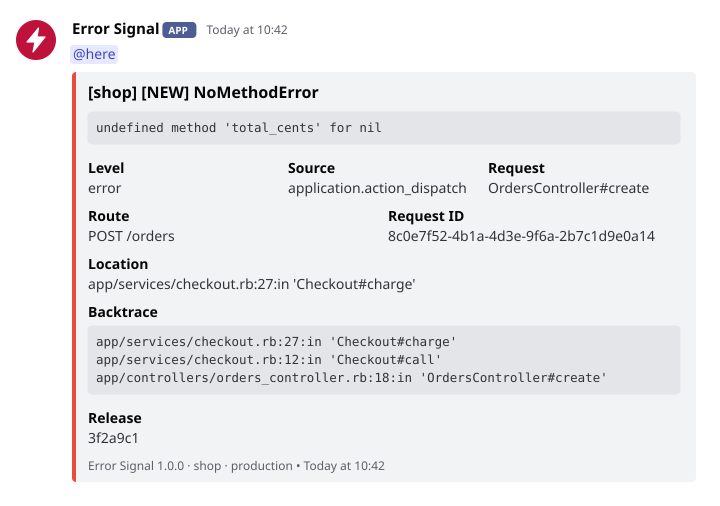
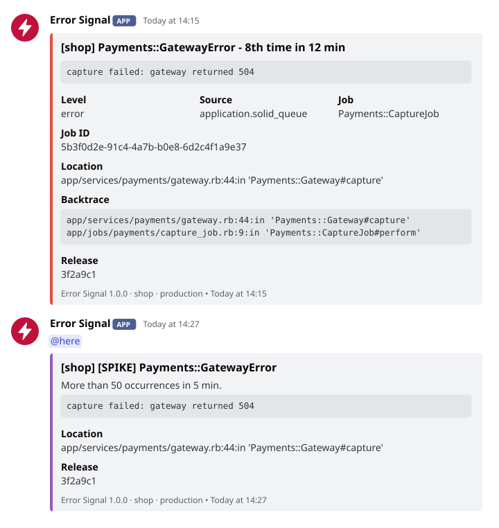
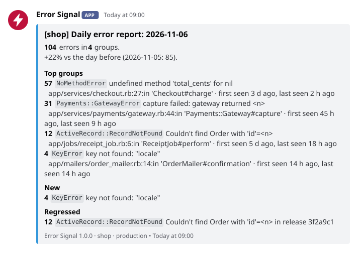
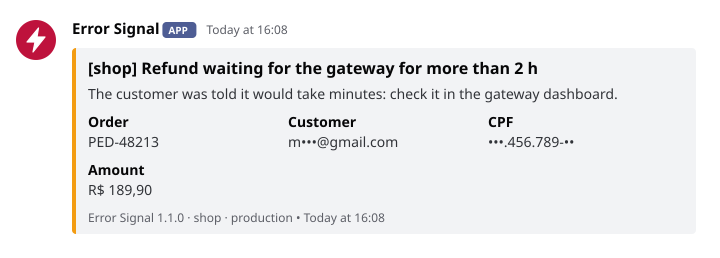

# Error Signal

[English](README.md) | Português

[](https://github.com/matt-3/error_signal/actions/workflows/test.yml)
[](LICENSE)


**Alertas no estilo do Sentry e relatórios diários e semanais de erros para Rails, postados
no Discord: de graça, sem serviço, sem banco de dados, sem dados pessoais.** O Error Signal
escuta o `Rails.error`, o reporter de erros que toda app Rails tem, agrupa o que ouve,
avisa quando um erro é novo, quando voltou depois de um deploy e quando dispara, e manda
um relatório diário e outro semanal no mesmo canal.

<picture>
  <source media="(prefers-color-scheme: dark)" srcset="docs/assets/alert-dark.svg">
  
</picture>

- **Nada para rodar.** Sem serviço, sem agente, sem banco: uma linha no Gemfile e a URL de
  um webhook. Sem initializer e sem chamada no seu código.
- **Alertas que dizem o que mudou.** `[NEW]`, `[REGRESSED]` depois de um deploy, `[SPIKE]`.
  Um erro repetido posta na 1ª, 2ª, 4ª, 8ª... ocorrência, então um loop manda meia dúzia
  de mensagens, não centenas.
- **Relatórios no canal.** Toda manhã o dia anterior, toda semana a tendência: totais,
  grupos mais frequentes, o que é novo, o que voltou, o que sumiu.
- **Sem dados pessoais.** A mensagem, o backtrace e os IDs passam por um sanitizador antes
  de sair: o dado pessoal fica só com a parte que distingue um registro do outro
  (`•••.456.789-••`, `j•••@gmail.com`, `•••• 4242`), os segredos somem inteiros
  (`[FILTERED]`). Nada mais da requisição sai: nem parâmetros, nem headers, URL, sessão ou
  usuário.
- **Do seu jeito.** Você escolhe o que dispara pelo nível, pela classe, pela origem ou por
  uma regra em Ruby, e manda os seus próprios avisos com o `ErrorSignal.message`.
- **Seguro em produção.** Nunca levanta erro, nunca segura uma requisição (o POST roda
  numa thread com timeouts curtos) e custa poucas operações de cache por erro.
- **Com ou sem o Sentry.** Os dois escutam o `Rails.error` lado a lado.

## Conteúdo

- [Começo rápido](#começo-rápido)
- [O que ela captura](#o-que-ela-captura)
- [Alertas](#alertas)
- [Relatórios](#relatórios)
- [Exemplos por cenário](#exemplos-por-cenário)
- [Configuração](#configuração)
- [Sanitizador](#sanitizador)
- [Tasks do Rake](#tasks-do-rake)
- [Compatibilidade](#compatibilidade)
- [Comparada com o Sentry e com a exception_notification](#comparada-com-o-sentry-e-com-a-exception_notification)
- [Perguntas frequentes](#perguntas-frequentes)
- [Como contribuir](#como-contribuir)
- [Licença](#licença)

## Começo rápido

1. Acrescente a gem no `Gemfile` e rode `bundle install`:

   ```ruby
   gem "error_signal", git: "https://github.com/matt-3/error_signal.git", tag: "v1.0.0"
   ```

2. Crie um webhook no Discord (*Configurações do servidor > Integrações > Webhooks > Novo
   webhook > Copiar URL do webhook*) e defina no ambiente da app:

   ```bash
   DISCORD_WEBHOOK_URL=https://discord.com/api/webhooks/<id>/<token>
   ```

3. Confira a configuração e mande um erro de teste:

   ```bash
   bin/rails error_signal:check   # todas as configurações, não envia nada
   bin/rails error_signal:test    # um erro de teste pelo Rails.error
   ```

É só isso: sem initializer. Por padrão ela posta só em `production` (para testar na sua
máquina: `ERROR_SIGNAL_ENVIRONMENTS=development bin/rails error_signal:test`). Para os
relatórios, agende o `ErrorSignal::DigestJob` ([Relatórios](#relatórios)); para distinguir
os erros que voltaram, informe uma release (`ERROR_SIGNAL_RELEASE`, ou a `SENTRY_RELEASE` ou
o `GIT_REV` que o seu deploy já define).

> [!TIP]
> Se nada chegar ao canal, o `bin/rails error_signal:check` diz por quê: sem webhook, um
> ambiente que não posta ou o `Rails.error` sem assinatura.

## O que ela captura

O Rails reporta ao `Rails.error` sozinho; o Error Signal acrescenta as tasks do rake e os
cantos do `rails runner`. Conferido do Rails 7.1 ao 8.1:

| Onde o erro acontece | Quem reporta | Origem mostrada |
|---|---|---|
| Uma action de controller | `ActionDispatch::Executor` (não quando o Rails responde com 4xx) | `application.action_dispatch` |
| Um endpoint Rack ou um middleware abaixo do executor | `ActionDispatch::Executor` | `application.action_dispatch` |
| Um job rodado pelo adapter inline ou async | `ActiveJob::Base.execute`, dentro do executor da app | `application.active_support` |
| Um job rodado pelo Solid Queue | o worker dele, dentro do executor da app | `application.solid_queue` |
| `bin/rails runner` | o executor em que o Rails embrulha o runner | `application.runner.railties` |
| `rails runner --skip-executor` (Rails 7.2+), ou um `LoadError` no runner | o gancho `at_exit` do Error Signal | `runner.error_signal` |
| Uma task do rake (`rake task` ou `bin/rails task`) | o gancho de rake do Error Signal, com o nome da task | `rake.error_signal` |
| `Rails.error.record { }` | `Rails.error`, não tratado | `application` |
| `Rails.error.report(e, severity: :error)`, `Rails.error.handle(severity: :error) { }` | `Rails.error`, tratado: aparece como `error (handled)` | `application` |

Uma exceção nunca é postada duas vezes: o Error Signal marca o que recebe, o Rails marca o
que reporta, e os ganchos do rake e do runner pulam as duas marcas. Antes que uma task do
rake ou um script do runner que falhou termine, um gancho `at_exit` espera até 5 segundos
pelos posts em andamento.

**O que ela não posta** (nem conta nos relatórios):

- nada fora de `ERROR_SIGNAL_ENVIRONMENTS`, ou abaixo de `ERROR_SIGNAL_MIN_LEVEL` (então
  `Rails.error.handle { }` e `Rails.error.report(e)`, avisos tratados, ficam de fora por
  padrão);
- erros de requisição que o Rails responde com 4xx (`RecordNotFound`, `RoutingError`,
  `ParameterMissing`...);
- a lista padrão de ruído, venha de onde vier: `ActionController::InvalidAuthenticityToken`,
  `ActionController::UnknownFormat`, `ActionController::BadRequest`,
  `ActionDispatch::Http::MimeNegotiation::InvalidType` e
  `ActionController::InvalidCrossOriginRequest`, mais a sua `ERROR_SIGNAL_IGNORE_EXCEPTIONS`;
- erros de requisições feitas por robôs de busca (Googlebot, bingbot, GPTBot, ClaudeBot e
  os nomes genéricos `bot`, `crawl` e `spider`; um celular como o "CUBOT X20" não é robô);
- as origens da `ERROR_SIGNAL_IGNORE_SOURCES`, os erros tratados com
  `ERROR_SIGNAL_REPORT_HANDLED=false` e o que as suas regras do `ErrorSignal.ignore_if`
  pegarem ([Escolhendo o que dispara](#escolhendo-o-que-dispara));
- falhas do cache store (o agrupamento depende desse cache: postá-las seria uma
  enxurrada);
- `perform_now` fora de qualquer executor (um console, um script simples): o Rails nunca
  fica sabendo, o erro só sobe para quem chamou.

Ela não vê erros do navegador (JavaScript), requisições lentas nem nada que não seja uma
exceção.

## Alertas

Toda mensagem é postada como **Error Signal**, com o nome da app no título e no rodapé,
então várias apps podem dividir um canal. O embed é vermelho para `error`, laranja para
`warning`, azul para `info` e roxo para um pico. Cada alerta diz onde o erro aconteceu: a
origem, a action do controller e a rota (`GET /orders/:id`, o padrão que o Rails
encontrou, nunca a URL), o ID da requisição, ou o job e o ID dele, mais o local, as linhas
da app no backtrace e a release.

### Agrupamento

Cada ocorrência ganha uma impressão digital: a classe da exceção, a primeira linha do
backtrace que pertence à app **sem o número da linha** (um deploy que só desloca linhas
mantém o grupo) e a mensagem com as partes variáveis trocadas (números, IDs hexadecimais,
UUIDs, e-mails, hashes longos, dados entre aspas). `Record 123 not found` e
`Record 456 not found` são um grupo; `undefined method 'name'` e `undefined method 'email'`
são dois. O alerta mostra a mensagem original, sanitizada.

### Novos e que voltaram

Cada grupo fica guardado por 30 dias:

- **`[NEW]`**: um grupo que não apareceu nos últimos 30 dias.
- **`[REGRESSED]`**: um grupo que volta depois de pelo menos um dia quieto, numa release
  diferente daquela em que foi visto por último. O alerta acrescenta **Previously seen**
  (`3 d ago, in release 9b1e4d7`). Sem release, nada é marcado como volta.

Com `ERROR_SIGNAL_LOCALE=pt-BR` os marcadores ficam `[NOVO]`, `[VOLTOU]` e `[PICO]`.

### Repetição: as potências de dois

Dentro de uma rajada, um grupo posta na 1ª, 2ª, 4ª, 8ª, 16ª... ocorrência, com a contagem
e o tempo desde o início da rajada no título (`8th time in 12 min`). A rajada termina
depois de `ERROR_SIGNAL_GROUPING_WINDOW` (1 hora) de silêncio. O contador é o
`Rails.cache.increment`, atômico em todo cache store, então vale entre os workers do Puma
e os processos de job. Se o cache falhar, toda ocorrência é postada, sem contagem nem
marcador: um alerta duplicado é melhor que um alerta perdido.

### Pico

Mais de `ERROR_SIGNAL_SPIKE` ocorrências (50) de um grupo numa janela de 5 minutos postam
uma mensagem `[SPIKE]` à parte, uma vez por janela, mesmo com muitos workers.

<picture>
  <source media="(prefers-color-scheme: dark)" srcset="docs/assets/repeat-dark.svg">
  
</picture>

### Menção

A `DISCORD_MENTION` (`@here`, `@everyone`, `<@&ID_DO_CARGO>`, `<@ID_DO_USUÁRIO>`, várias
separadas por espaço) vai só nas mensagens de erro novo, de volta e de pico. Toda mensagem
define `allowed_mentions`, então nada mais nela pinga alguém: uma mensagem de exceção que
contenha `@everyone` fica inerte.

### Quando não cabe

O Discord recusa uma mensagem com mais de 6000 caracteres no total, tenha quantos embeds
tiver. A mensagem fica com o que se lê de relance e, quando algo foi cortado, leva um
arquivo de texto com tudo, sanitizado:

| Mensagem | O arquivo anexado |
|---|---|
| Alerta | os campos, a mensagem inteira e o backtrace inteiro, com as linhas das gems (até 200) |
| `ErrorSignal.message` | o texto inteiro e todos os campos |
| Relatório diário | todos os grupos do dia, não só os 10 maiores |
| Relatório semanal | todos os grupos das duas semanas, com as duas contagens (sempre, porque a mensagem lista só o que mais mudou) |

Uma mensagem que cabe não leva arquivo. Se o Discord recusar o arquivo, a mensagem sai
sem ele.

## Relatórios

O `ErrorSignal::DigestJob` (um Active Job, definido quando a sua app carrega o Active Job)
e a task `error_signal:digest` postam dois relatórios, no idioma configurado e dentro dos
limites do Discord:

- **diário** (o padrão): o dia anterior, das 00:00 às 24:00 no `config.time_zone`,
  comparado com o dia antes dele; os 10 grupos mais frequentes com o local e quando foram
  vistos pela primeira e pela última vez; os grupos novos e os que voltaram no dia.
- **semanal**: os últimos 7 dias contra os 7 anteriores, a contagem por dia, os grupos que
  mais cresceram, os que sumiram e as voltas depois de um deploy.

<picture>
  <source media="(prefers-color-scheme: dark)" srcset="docs/assets/digest-dark.svg">
  
</picture>

### Agendamento

Com o Solid Queue, no `config/recurring.yml`. O Solid Queue lê o agendamento no fuso do
processo (em geral UTC), então termine cada agendamento com o fuso da app:

```yaml
<% zone = ActiveSupport::TimeZone[Rails.application.config.time_zone].tzinfo.name %>
production:
  error_signal_daily:
    class: ErrorSignal::DigestJob
    args: [ "daily" ]
    queue: default # uma fila com worker no config/queue.yml
    schedule: "0 9 * * * <%= zone %>"
  error_signal_weekly:
    class: ErrorSignal::DigestJob
    args: [ "weekly" ]
    queue: default
    schedule: "0 9 * * 1 <%= zone %>"
```

Com o cron (ponha a task entre aspas: os colchetes são especiais no shell):

```cron
CRON_TZ=America/Sao_Paulo
0 9 * * *  cd /app && bin/rails "error_signal:digest[daily]"
0 9 * * 1  cd /app && bin/rails "error_signal:digest[weekly]"
```

Agende o relatório diário mesmo se você só lê o semanal: é a execução diária que registra
um dia tranquilo como um dia sem erros.

### Onde ficam os dados

No `Rails.cache`, com o prefixo `error_signal:`, cada chave com a sua validade: a contagem
e uma amostra sanitizada por grupo e dia (15 dias), o estado de cada grupo (30 dias) e uma
chave de histórico com os resumos dos últimos 14 dias, reescrita por todo relatório.
Reescrito todo dia, o histórico sobrevive a um cache que expira entradas antigas (o
`max_age` do Solid Cache) ou que descarta por tamanho, então o relatório semanal funciona
mesmo quando as chaves diárias da semana passada já sumiram. O relatório avisa quando os
dados estão incompletos: dias faltando, mais de 1.000 grupos num dia, ou um store que fica
por processo ou por máquina.

> [!NOTE]
> Com um cache em memória (`MemoryStore`), cada processo conta sozinho e as contagens
> zeram ao reiniciar. Em produção, um store compartilhado (Solid Cache, Redis, Memcached)
> faz o agrupamento e os relatórios cobrirem todos os processos.

## Exemplos por cenário

### Só o Discord

Uma app em produção no Dokku, no Kamal, no Heroku ou num servidor comum. No ambiente da
app:

```bash
DISCORD_WEBHOOK_URL=https://discord.com/api/webhooks/<id>/<token>
DISCORD_MENTION=@here            # pinga nas mensagens de erro novo, de volta e de pico
ERROR_SIGNAL_APP_NAME=loja       # o nome no título e no rodapé
# A release: o Dokku define o GIT_REV a cada deploy; nos outros, defina ERROR_SIGNAL_RELEASE.
```

Depois agende os relatórios ([Agendamento](#agendamento)) e rode
`bin/rails error_signal:test` uma vez no servidor.

### Junto com o Sentry

Nada para ligar. O Sentry e o Error Signal assinam o `Rails.error`, então todo erro chega
aos dois: o Sentry guarda o histórico, a interface e os traces; o Discord avisa na hora.
Não há `before_send` para escrever nem chamada para acrescentar.

```bash
SENTRY_DSN=https://...@sentry.io/...
SENTRY_RELEASE=3f2a9c1                # o Error Signal também usa, quando a ERROR_SIGNAL_RELEASE está vazia
DISCORD_WEBHOOK_URL=https://discord.com/api/webhooks/<id>/<token>
```

O `bin/rails error_signal:test` passa pelo `Rails.error`, então o erro de teste aparece
nos dois. O Error Signal filtra os dados pessoais com o próprio sanitizador, independente
das configurações do Sentry; defina o `ErrorSignal.sanitizer` se quiser uma regra só para
os dois ([Um sanitizador próprio](#um-sanitizador-próprio)).

### Uma app brasileira

Mensagens em português, CPF, CNPJ e celulares sem separador mascarados, dias dos
relatórios no horário de São Paulo:

```bash
ERROR_SIGNAL_LOCALE=pt-BR
ERROR_SIGNAL_PII_RULES=br
```

```ruby
# config/application.rb
config.time_zone = "America/Sao_Paulo"
```

`CPF 123.456.789-09 inválido` chega ao Discord como `CPF •••.456.789-•• inválido`, o
bastante para achar o cliente no seu banco; um CNPJ fica com a raiz e a filial
(`••.345.678/0001-••`), e um número de pedido de 11 dígitos com dígitos verificadores
errados continua inteiro. Os títulos ficam `[loja] [NOVO] NoMethodError` e `[loja] NoMethodError - 8ª vez em 12 min`.

### Escolhendo o que dispara

O Rails reporta mais do que quedas: erros tratados, avisos, falhas de job e de rake,
depreciações quando você pede. Cada configuração abaixo estreita o que chega ao canal, e
o `bin/rails error_signal:check` mostra todas:

```bash
# A menor severidade postada (padrão error): info, warning ou error.
ERROR_SIGNAL_MIN_LEVEL=warning

# Nunca postadas: a classe e o que herdar dela (módulos incluídos).
ERROR_SIGNAL_IGNORE_EXCEPTIONS=Rack::Timeout::RequestTimeoutException,Loja::PagamentoRecusado

# Origens deixadas de fora, pelo começo do nome: o campo Origem do alerta mostra o nome a copiar.
ERROR_SIGNAL_IGNORE_SOURCES=application.active_job,deprecation

# Só o que a app não resgatou: Rails.error.handle e Rails.error.report ficam de fora.
ERROR_SIGNAL_REPORT_HANDLED=false
```

Para uma regra que uma variável de ambiente não consegue dizer, um bloco num initializer.
Ele recebe a exceção e o evento (`source`, `severity`, `handled`, `context` e `manual`,
verdadeiro no `ErrorSignal.notify`) e devolve `true` para pulá-la:

```ruby
# config/initializers/error_signal.rb
ErrorSignal.ignore_if do |error, event|
  error.is_a?(Net::ReadTimeout) && event.context[:job].is_a?(SincronizaParceiroJob)
end
```

As regras se somam. Uma regra que levanta erro é pulada e registrada no log, e o erro é
postado: um alerta perdido custa mais do que um a mais.

Para silenciá-la num bloco, do jeito que o Rails documenta:

```ruby
Rails.error.disable(ErrorSignal::Subscriber) do
  ImportadorAntigo.run # barulhento e conhecido
end
```

`ERROR_SIGNAL_IGNORE_EXCEPTIONS_DEFAULTS=false` desliga a lista padrão de ruído, e
`ERROR_SIGNAL_IGNORE_CRAWLERS=false` posta também os erros de robôs.

### Vários ambientes

A `ERROR_SIGNAL_ENVIRONMENTS` lista os ambientes do Rails em que ela posta; cada ambiente
tem as próprias variáveis, então cada um pode postar no próprio canal:

```bash
# servidor de produção
DISCORD_WEBHOOK_URL=https://discord.com/api/webhooks/<id-prod>/<token>
DISCORD_MENTION=@here

# servidor de staging (RAILS_ENV=staging)
DISCORD_WEBHOOK_URL=https://discord.com/api/webhooks/<id-staging>/<token>
ERROR_SIGNAL_ENVIRONMENTS=staging
ERROR_SIGNAL_APP_NAME=loja-staging
```

Um staging que roda com `RAILS_ENV=production` só precisa do próprio webhook e do próprio
nome. O rodapé sempre mostra o `Rails.env`. Em development e test nada é postado nem
contado, a não ser que você os liste.

### Um sanitizador próprio

Qualquer objeto que responda a `call(String) -> String`, definido uma vez num initializer:

```ruby
# config/initializers/error_signal.rb
ErrorSignal.sanitizer = lambda do |text|
  ErrorSignal::Sanitizer.call(text).gsub(/\bPED-\d{6}\b/, "[FILTERED]")
end
```

Um sanitizador próprio substitui o embutido; chamar o `ErrorSignal::Sanitizer` dentro
dele, como acima, mantém as regras globais e os pacotes da `ERROR_SIGNAL_PII_RULES`. Se ele
levantar erro, o texto é trocado por `[sanitization failed]` (`[erro ao sanitizar]` em
português): nada sai sem sanitizar.

### Reportando um erro tratado

Um erro que você resgata fica invisível a não ser que você o reporte. Pelo `Rails.error`,
o Sentry e qualquer outro assinante também o veem:

```ruby
def capturar
  gateway.capture(pedido)
rescue Pagamentos::GatewayError => e
  Rails.error.report(e, severity: :error) # postado como "error (handled)"
  pedido.tentar_depois!
end

# ou, para um bloco:
Rails.error.handle(Pagamentos::GatewayError, severity: :error) { gateway.capture(pedido) }
```

O `severity: :error` importa: um report tratado é `warning` por padrão, abaixo da
`ERROR_SIGNAL_MIN_LEVEL` padrão. Para postar só no Discord, sem os outros assinantes:

```ruby
ErrorSignal.notify(e, context: { request_id: request.request_id })
```

O `notify` recebe `context:` (`controller:`, `job:`, `request_id:`, `rake_task:`) e
`severity:` (padrão `:error`), passa pelos mesmos filtros, agrupamento e sanitizador, e
volta na hora. Outras chaves do contexto nunca são postadas. Um script que termina com
`exit!` pula os ganchos `at_exit`: chame `ErrorSignal.flush` antes.

### Mandando um aviso à mão

Para o que não é exceção mas a equipe precisa saber, o `ErrorSignal.message` posta um
texto com campos:

<picture>
  <source media="(prefers-color-scheme: dark)" srcset="docs/assets/message-dark.svg">
  
</picture>

```ruby
ErrorSignal.message(
  "Reembolso esperando o gateway há mais de 2 h\n" \
  "O cliente ouviu que levaria minutos: confira no painel do gateway.",
  level: :warning,                       # :info (padrão), :warning ou :error: a cor
  fields: { "Pedido" => pedido.numero, "Cliente" => pedido.email, "CPF" => pedido.cpf, "Valor" => pedido.total_formatado },
  mention: false                         # true acrescenta a DISCORD_MENTION
)
```

A primeira linha é o título e o resto vai embaixo; tudo, inclusive os nomes e os valores
dos campos, passa pelo sanitizador. O mesmo texto posta na 1ª, 2ª, 4ª, 8ª... vez dentro da
`ERROR_SIGNAL_GROUPING_WINDOW`, então um loop não inunda o canal; textos que mudam
(`"Estoque do produto #{id} zerou"`) se agrupam com uma `key: "estoque"` comum. Um aviso
não é um erro: não entra nos relatórios, e a `ERROR_SIGNAL_MIN_LEVEL` e as regras de
ignorar não valem para ele. Ele só posta nos `ERROR_SIGNAL_ENVIRONMENTS`, devolve `true`
quando o aviso sai e nunca levanta erro. Pelo terminal:
`bin/rails runner 'ErrorSignal.message("Backup restaurado")'`.

## Configuração

Variáveis de ambiente, lidas a cada uso (uma mudança vale sem reiniciar). As duas
`DISCORD_*` pertencem ao canal do Discord; as outras, ao Error Signal.

### O canal

| Variável | Padrão | O que faz |
|---|---|---|
| `DISCORD_WEBHOOK_URL` | (nenhum) | O webhook do Discord. Sem ele, o Error Signal não faz nada. |
| `DISCORD_MENTION` | (nenhum) | Menção nas mensagens de erro novo, de volta e de pico: `@here`, `@everyone`, `<@&ID_DO_CARGO>`, `<@ID_DO_USUÁRIO>`. Outro texto é ignorado. |

### O que dispara

| Variável | Padrão | O que faz |
|---|---|---|
| `ERROR_SIGNAL_ENVIRONMENTS` | `production` | Ambientes do Rails, separados por vírgula, em que ela posta e conta. |
| `ERROR_SIGNAL_MIN_LEVEL` | `error` | A menor severidade postada: `info`, `warning` ou `error` (`debug` vale como `info`, `fatal` como `error`, um valor inválido como o padrão). |
| `ERROR_SIGNAL_IGNORE_EXCEPTIONS` | (nenhum) | Nomes de classe, separados por vírgula, nunca postados, comparados com a classe e os ancestrais dela. As classes não precisam estar carregadas. |
| `ERROR_SIGNAL_IGNORE_EXCEPTIONS_DEFAULTS` | `true` | `false` desliga a lista padrão de ruído. |
| `ERROR_SIGNAL_IGNORE_CRAWLERS` | `true` | `false` posta também os erros de requisições de robôs. |
| `ERROR_SIGNAL_IGNORE_SOURCES` | (nenhum) | Começos de nome de origem, separados por vírgula, nunca postados (`application.active_job`). As falhas do cache store ficam sempre de fora. |
| `ERROR_SIGNAL_REPORT_HANDLED` | `true` | `false` posta só o que a app não resgatou. O `ErrorSignal.notify` sempre posta. |

### Agrupamento e pico

| Variável | Padrão | O que faz |
|---|---|---|
| `ERROR_SIGNAL_GROUPING_WINDOW` | `1h` | Tempo de silêncio que encerra uma rajada: segundos (`3600`) ou um número com `s`, `m`, `h` ou `d` (`30m`, `2h`). |
| `ERROR_SIGNAL_SPIKE` | `50` | Ocorrências de um grupo em 5 minutos acima das quais sai uma mensagem de pico. `0` desliga. |

### Dados pessoais

| Variável | Padrão | O que faz |
|---|---|---|
| `ERROR_SIGNAL_PII_RULES` | (nenhum) | Pacotes por país do sanitizador: `br`, `us`, `uk`, `in`, `eu`. |
| `ERROR_SIGNAL_MASK` | `partial` | `partial` mantém a parte do dado pessoal que distingue um registro do outro; `full` troca o dado inteiro por `[FILTERED]`. Os segredos somem sempre inteiros. |

### Identidade e idioma

| Variável | Padrão | O que faz |
|---|---|---|
| `ERROR_SIGNAL_APP_NAME` | o nome do módulo da app | O nome no título e no rodapé (`loja` para `Loja::Application`). |
| `ERROR_SIGNAL_RELEASE` | `SENTRY_RELEASE`, depois `GIT_REV` | A release mostrada nos alertas e usada para distinguir as voltas. |
| `ERROR_SIGNAL_LOCALE` | `en` | Idioma das mensagens: `en` ou `pt-BR` (`pt_BR` e `pt` também valem). |

Fixos de propósito: a janela do pico (5 minutos), a memória de um grupo (30 dias), o dia
quieto de uma volta, as chaves diárias (15 dias), o histórico (14 dias), os grupos por dia
(1.000), os timeouts do POST (2 s para abrir, 3 s para ler) e a espera na saída (5 s).

## Sanitizador

A mensagem da exceção, o local, o backtrace, o ID da requisição, o ID do job e o nome da
task passam por um sanitizador antes de serem postados, e as amostras dos relatórios
antes de serem guardadas. A falha é fechada: se ele levantar erro, sai
`[sanitization failed]` no lugar do texto. O sanitizador em uso é o seu, se você definir o
`ErrorSignal.sanitizer` ([exemplo](#um-sanitizador-próprio)), ou o embutido
`ErrorSignal::Sanitizer`, que tem duas camadas.

### Mascarado, não apagado

Um alerta que esconde o CPF inteiro não diz qual cliente falhou. Por isso o dado pessoal
fica com uma parte, nunca o bastante para reconstruí-lo, e os segredos somem sempre
inteiros:

| Dado | Chega ao Discord como |
|---|---|
| E-mail | `j•••@gmail.com`: a primeira letra e o domínio, sempre três pontos |
| Telefone | `(••) •••••-5678`, `+•• •• •••••-5678`: os 4 últimos |
| Cartão | `•••• •••• •••• 4242`: os 4 últimos |
| IBAN, IVA | `GB•• •••• •••• •••• ••54 32`, `DE•••••6789`: o país e os 4 últimos |
| CPF | `•••.456.789-••`: os 6 dígitos do meio, como o governo mascara |
| CNPJ | `••.345.678/0001-••`: 6 dígitos da raiz e a filial (os últimos dígitos são a filial, `0001` na maioria das empresas, e os verificadores) |
| SSN, EIN, NI, Aadhaar, PAN | `•••-••-6789`: os 4 últimos |
| Senhas, tokens, chaves, cookies, hashes longos | `[FILTERED]`, inteiros |

Um número curto nunca mostra mais da metade dos dígitos. O ponto é `•`, não `*`, que o
Discord lê como negrito. A `ERROR_SIGNAL_MASK=full` troca também o dado pessoal por
`[FILTERED]`. O agrupamento usa a mensagem original, então a máscara nunca separa nem
junta grupos.

### Regras globais (sempre ligadas)

Mascarados:

- e-mails;
- telefones: com `+` (`+55 11 91234-5678`, `+1 (415) 555-2671`, `+44 20 7946 0958`), com
  DDD entre parênteses, norte-americanos (`415-555-2671`), locais com hífen (`91234-5678`)
  e com o 0 de longa distância (`020 7946 0958`, `01 23 45 67 89`);
- cartões de pagamento, de 13 a 19 dígitos **válidos pelo Luhn**, e IBANs **válidos pelo
  módulo 97**.

Trocados inteiros por `[FILTERED]`:

- JSON Web Tokens, tokens `Bearer` e credenciais `Basic`;
- chaves com prefixo conhecido: AWS, Stripe, GitHub, Google, Slack, e URLs de webhook do
  Discord;
- valores depois de `password`, `secret`, `token`, `api_key`, `access_key`, `private_key`,
  `credential`, `authorization` e `session`; headers de cookie inteiros; parâmetros
  sensíveis da query string (os outros ficam);
- segredos longos: 32+ dígitos hexadecimais, ou 32+ caracteres misturando maiúsculas,
  minúsculas e dígitos.

Ficam como estão, e há teste para isso: datas e horas, intervalos de anos, versões
(`8.1.4.1`), UUIDs, números de pedido (`12345`, `#123456789`, `ORD-2026-0001`), números que
não passam no Luhn, preços (`$1,234.56`, `R$ 1.234,56`), IPs, portas, SHAs curtos, linhas
de backtrace e constantes Ruby (`Devise::Token::Error`).

### Pacotes por país (opcionais)

Documentos nacionais têm formatos que comeriam números comuns em qualquer outro lugar,
então cada país é um pacote que você liga na `ERROR_SIGNAL_PII_RULES`:

| Pacote | Mascara |
|---|---|
| `br` | CPF e CNPJ (numérico e o CNPJ alfanumérico emitido desde julho de 2026): com pontuação sempre, só dígitos apenas com dígitos verificadores válidos; celulares sem separador (`11912345678`) |
| `us` | Social Security numbers (`123-45-6789`) e EINs (`12-3456789`) |
| `uk` | National Insurance numbers (`AB 12 34 56 C`) |
| `in` | Aadhaar (12 dígitos, dígito verificador Verhoeff) e PAN (`ABCPE1234F`) |
| `eu` | Números de IVA com o prefixo do país (`DE123456789`, `FR 12 345678901`, `NL123456789B01`) |

> [!WARNING]
> Os pacotes são opcionais: sem `ERROR_SIGNAL_PII_RULES=br`, um CPF ou um CNPJ na mensagem
> de uma exceção chega ao Discord como está. Ligue os pacotes dos países de onde vêm os
> seus usuários.

## Tasks do Rake

| Comando | O que faz |
|---|---|
| `bin/rails error_signal:check` | cada configuração com o valor efetivo, se este ambiente posta, a assinatura do `Rails.error`, o sanitizador, o cache store e o que ele significa para os dados, o histórico dos relatórios; não envia nada |
| `bin/rails error_signal:test` | um erro de teste pelo `Rails.error`, como um de verdade (os outros assinantes também recebem) |
| `bin/rails error_signal:test_repeat` | o mesmo erro 5 vezes: chegam a 1ª, a 2ª e a 4ª |
| `bin/rails error_signal:clear_dedupe` | encerra as rajadas atuais, para o próximo erro postar na hora; só toca as chaves de agrupamento do Error Signal |
| `bin/rails "error_signal:digest[daily]"` | posta o relatório diário agora (`weekly` para o semanal) |

No Dokku: `dokku run <app> bin/rails error_signal:test`.

## Compatibilidade

| | Rails 7.1 | Rails 7.2 | Rails 8.0 | Rails 8.1 |
|---|---|---|---|---|
| Ruby 3.4 | CI | CI | CI | CI |
| Ruby 4.0 | CI | CI | CI | CI |

O gemspec aceita Ruby 3.2 ou mais novo e `activesupport`/`railties` `>= 7.1, < 9`; o CI
roda os oito pares acima (`gemfiles/`). Qualquer cache store do Rails funciona; um
compartilhado e persistente (Solid Cache, Redis, Memcached) faz o agrupamento e os
relatórios cobrirem todos os processos.

## Comparada com o Sentry e com a exception_notification

O Sentry é um rastreador de erros completo; o Error Signal não é. A tabela serve para
ajudar na escolha, não para dizer que se equivalem.

| | Error Signal | Sentry | [exception_notification](https://github.com/smartinez87/exception_notification) |
|---|---|---|---|
| Onde roda | Dentro da app | Serviço hospedado (ou auto-hospedado) | Dentro da app |
| Preço | Grátis (MIT) | Plano gratuito com cota de eventos; a integração com o Discord exige plano pago | Grátis (MIT) |
| Para onde vão os erros | Discord | A interface dele, mais e-mail, Slack, Discord (pago) e outros | E-mail, Slack, Teams, um webhook e outros; sem notificador para o Discord |
| Como se conecta | `Rails.error`, mais ganchos no rake e no `rails runner` | SDK com integrações para Rails, Rack, jobs e rake | Middleware do Rack e integrações com jobs |
| Agrupamento | Classe + primeira linha da app + mensagem normalizada | Fingerprint pelo stack trace, juntar e separar na interface | Opcional, por classe e mensagem ou backtrace |
| Erros repetidos | 1ª, 2ª, 4ª, 8ª... ocorrência de uma rajada | Regras de alerta | 1ª, 2ª, 4ª, 8ª... ocorrência |
| Novos e que voltaram | Sim, 30 dias no `Rails.cache` | Sim, com histórico completo | Não |
| Picos | Por grupo, mais de N em 5 minutos | Regras de alerta e detecção de anomalias | Não |
| Relatórios | Diário e semanal, no Discord | E-mail semanal | Não |
| Dados pessoais | Sanitizados antes de sair, com falha fechada; sem parâmetros, headers ou URL | Limpos pelo SDK e pelo servidor | Envia parâmetros, sessão e ambiente, filtrados pelo `filter_parameters` |
| Histórico, busca, interface | Não | Sim | Não |
| Performance, traces, erros do navegador | Não | Sim | Não |

A repetição em potências de dois e o filtro de robôs são ideias da exception_notification,
com agradecimento. Para um histórico de erros com interface guardado no seu próprio banco,
veja a [solid_errors](https://github.com/fractaledmind/solid_errors), que também assina o
`Rails.error` e funciona ao lado do Error Signal sem configuração.

## Perguntas frequentes

### Peso e segurança

<details>
<summary><b>Ela pesa quanto?</b></summary>

Muito pouco. Por requisição, uma escrita e uma restauração de uma variável local da fiber
(um middleware minúsculo deixa o env da requisição ao alcance, para o User-Agent, o ID da
requisição e a rota). Por erro reportado, os filtros, um SHA-256 de um texto curto, uma
leitura de cache e até três incrementos, mais algumas escritas quando um grupo começa uma
rajada. O POST roda numa thread com timeouts curtos e, de propósito, fora do Active Job:
se a fila cair, é justamente quando você quer saber. As únicas dependências são
`activesupport` e `railties`.

</details>

<details>
<summary><b>Ela pode quebrar a minha app?</b></summary>

Não: ela nunca levanta erro. Qualquer falha dentro dela é engolida e registrada no log com
o prefixo `[ErrorSignal]`. Uma queda do Discord ou um `429` (cerca de 30 mensagens por
minuto por webhook) custa um alerta perdido, nunca uma requisição que falha.

</details>

<details>
<summary><b>E se uma mensagem for longa demais para o Discord?</b></summary>

Ela é cortada na mensagem e vai inteira num arquivo de texto anexado. O Discord recusa
uma mensagem com mais de 6000 caracteres no total, tenha quantos embeds tiver, então o
alerta fica com o que se lê de relance e o arquivo leva o resto, sanitizado ([Quando não
cabe](#quando-não-cabe)). Se o Discord recusar o arquivo, a mensagem sai sem ele.

</details>

### Dados e privacidade

<details>
<summary><b>O que sai da minha app?</b></summary>

Só o que você vê nas mensagens e nos arquivos anexados: a classe da exceção, a mensagem, o
local e as linhas do backtrace já sanitizados, a origem, o `Controller#action`, o padrão
da rota (`GET /orders/:id`) e o ID da requisição, a classe e o ID do job, o nome da task,
a release, o nome da app e o ambiente, mais os textos e campos que você passar ao
`ErrorSignal.message`, também sanitizados. Nunca parâmetros, headers, a URL, cookies,
sessão, usuário ou contexto próprio. O cache guarda só contagens e amostras sanitizadas.

</details>

<details>
<summary><b>Por que parte do CPF ou do e-mail continua visível?</b></summary>

Para você saber qual registro falhou. A parte visível nunca basta para reconstruir o valor
(o CPF fica com os 6 dígitos do meio, como o governo mascara; o cartão, com os 4 últimos),
os segredos somem sempre inteiros, e a `ERROR_SIGNAL_MASK=full` apaga também o dado
pessoal inteiro ([Mascarado, não apagado](#mascarado-não-apagado)).

</details>

### Instalação

<details>
<summary><b>Ela precisa do Sentry?</b></summary>

Não. Ela funciona sozinha, ou ao lado do Sentry, da solid_errors ou de qualquer outro
assinante do `Rails.error`.

</details>

<details>
<summary><b>Meu código chama `Sentry.capture_exception`. Isso chega ao Discord?</b></summary>

Não, só ao Sentry: o Error Signal escuta o `Rails.error`. Reporte por ele e os dois
recebem o erro: `Rails.error.report(e, context: { order_id: order.id })` no lugar de
`Sentry.capture_exception(e, ...)`. Para o `Sentry.capture_message`, use o
`ErrorSignal.message`.

</details>

<details>
<summary><b>Dá para postar algo que não é erro?</b></summary>

Dá, com o `ErrorSignal.message`: um texto com campos, sanitizado e agrupado ([Mandando um
aviso à mão](#mandando-um-aviso-à-mão)).

</details>

<details>
<summary><b>E se o meu cache for em memória?</b></summary>

Funciona, por processo. O `MemoryStore` fica dentro de cada processo: cada worker do Puma
conta as próprias rajadas (algumas mensagens a mais), as contagens zeram ao reiniciar e os
relatórios cobrem um processo só; o relatório avisa. O `NullStore` não guarda nada: toda
ocorrência posta e os relatórios ficam vazios. O `FileStore` é o disco de uma máquina. O
`bin/rails error_signal:check` diz qual você tem e o que isso significa.

</details>

<details>
<summary><b>Redis? Solid Cache?</b></summary>

Os dois funcionam, assim como o Memcached e qualquer cache store do Rails: os contadores
usam o `Rails.cache.increment`, atômico em todos. Com o Solid Cache, o `max_age` (7 dias
por padrão) não atrapalha: o histórico dos relatórios é reescrito todo dia.

</details>

<details>
<summary><b>Várias apps num canal só?</b></summary>

Sim: o título e o rodapé levam o nome da app (`ERROR_SIGNAL_APP_NAME`).

</details>

## Como contribuir

Relatos de bug, correções, regras do sanitizador, pacotes por país e traduções são
bem-vindos. Para uma mudança maior (uma dependência nova, uma configuração nova, uma
mudança no que é postado), abra uma issue antes. Detalhes no
[CONTRIBUTING.pt-BR.md](CONTRIBUTING.pt-BR.md).

```bash
bundle install
bundle exec rake test     # uma app Rails pequena, processos reais do rake e do runner, sem rede
bundle exec rubocop
```

Cada versão é uma tag `vX.Y.Z` com o mesmo número no `ErrorSignal::VERSION`; o que mudou
está no [CHANGELOG](CHANGELOG.md).

## Licença

[MIT](LICENSE).
